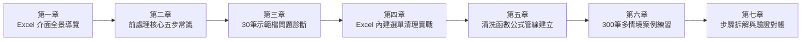

# 航運行政人員必修：MS Excel 基礎資料分析前處理實戰教學手冊

> 專為國際海運物流、船務代理、貨運承攬（Freight Forwarder）與報關業之初學者量身打造的電腦操作教學全套專案。聚焦於基礎資料分析中最核心的 20% 前處理基本功——包括 Excel 介面掌握、資料清洗常識、內建選單工具、關鍵清理函數、30 筆真實航運示範演練，以及 300 筆多情境綜合實戰練習。

---

## 📦 專案核心檔案清單 (Deliverables)

| 檔案名稱 | 格式 | 說明 |
| :--- | :---: | :--- |
| **[航運行政人員_Excel基礎資料前處理操作教學手冊.docx](航運行政人員_Excel基礎資料前處理操作教學手冊.docx)** | Word (`.docx`) | **完整教學手冊**（約 2.9 MB）。具備正式封面、導讀、章節目錄、圖表目錄、頁碼、頁首頁尾、**14 張高解析度操作截圖與圖解**、重點提示方塊（Callout），每章皆從頁頭分頁開始。 |
| **[航運行政人員_Excel基礎資料前處理實戰簡報.pptx](航運行政人員_Excel基礎資料前處理實戰簡報.pptx)** | PPT (`.pptx`) | **標準 16:9 簡報電子檔**（約 2.5 MB）。採高質感深海藍科技主題配色、內建原生圖形卡片、原生資料對帳表格，置入所有操作截圖與 SOP 圖解。 |
| **[shipping_excel_presentation.html](shipping_excel_presentation.html)** | 網頁 (`.html`) | **14 頁互動式簡報網頁**。支援全螢幕播放、鍵盤快捷鍵切換、投影片總覽網格、Excel 介面熱點探索器、**即時公式清洗模擬器**與**互動知識小測驗**。 |
| **[航運資料前處理教學_30筆示範檔.xlsx](航運資料前處理教學_30筆示範檔.xlsx)** | Excel (`.xlsx`) | **示範配套活頁簿**。內含 `01_原始資料(未清理)`、`02_港口標準代碼表`、`03_清洗完成標準資料`，供對照手冊第四、五章步驟操作。 |
| **[航運資料前處理實務_300筆情境練習檔.xlsx](航運資料前處理實務_300筆情境練習檔.xlsx)** | Excel (`.xlsx`) | **實戰挑戰題庫**。涵蓋 FCL、LCL、冷藏櫃、危險品 4 大型態（530 處缺陷），內含任務規格書、代碼表、參考解答資料庫與 KPI 查核對帳表。 |

---

## 📖 教學手冊章節架構

### 第一章：MS Excel 操作介面全景導覽
* **八大核心區域**：標題列、快速存取工具列、功能區（Ribbon）、名稱方塊、資料編輯列（顯微照妖鏡）、欄號列號座標系統、儲存格二維網格、工作表標籤與狀態列（即時統計平均/計數/加總）。
* **實戰截圖**：`images/fig_1_1_excel_ui.png`。

### 第二章：航運資料前處理核心常識與標準規範
* **GIGO 原則**：Garbage In, Garbage Out（垃圾進，垃圾出）的海運合約與報關風險。
* **三大不可動搖守則**：
  1. **原始資料保護原則**：永不在 Raw Data 上直接動刀，必建工作表複本。
  2. **標準二維表格（Tidy Data）**：一列一記錄、一行一屬性、單一標題列、**嚴禁跨欄合併儲存格**。
  3. **資料型態判別與對齊法則**：文字靠左、數值靠右、日期的底層數值序號真相。
* **八大髒資料特徵診斷**：前後多餘空格、不可見字元、大小寫混雜、俗稱港名、文字單位黏著、綠色三角文字數字、雜亂日期與重複拋轉。
* **黃金五步前處理流程 (SOP)**：防護備份 $\rightarrow$ 結構檢驗 $\rightarrow$ 字串代碼清洗 $\rightarrow$ 數值日期修復 $\rightarrow$ 遺漏補齊與驗收。

### 第三章：30 筆航運示範資料集——問題診斷與設計
* **15 大關鍵欄位定義**：項次、提單號碼（B/L No.）、船名航次、貨櫃號碼（11碼 ISO）、櫃型、裝貨港（POL）、卸貨港（POD）、開航日（ETD）、抵達日（ETA）、件數、毛重、體積（CBM）、海運費（USD）、託運人（Shipper）、報關放行狀態。
* **髒資料埋設診斷**：2 筆完全重複提單、文字單位 `KGS`/`kgs`/`$`、文字型數字、中文與俗稱港名（高雄、LAX、KHH）及空白漏填值。

### 第四章：實戰操作示範——Excel 內建選單功能篇
* 凍結首列與啟用自動篩選（`Ctrl+Shift+L`）。
* 【尋找與取代】快速批次剔除 ` KGS`、` kgs`、`$`、` USD`（`Ctrl+H`）。
* 【資料剖析精靈】三步驟拆分「船名與航次」。
* 【資料剖析精靈】選取「日期 YMD」一鍵修復文字雜亂日期。
* 【移除重複項】設定提單與櫃號雙鍵值，剔除 2 筆重複項。
* 【選擇性貼上 - 乘 1】神技消除文字數字的綠色錯誤三角提示。
* 【設定格式化的條件】視覺化高亮重複提單（紅色）與空白漏填值（黃色）。

### 第五章：實戰操作示範——函數公式清洗篇
* **文字三劍客**：`=UPPER(TRIM(CLEAN(B2)))` 一氣呵成去除換行、清空首尾空格並轉大寫。
* **字串截取與替換**：`LEFT`、`RIGHT`、`MID`、`FIND`、`LEN` 擷取貨櫃字首與檢查碼；`SUBSTITUTE` 替換分隔符號。
* **日期與數值**：`DATE(YEAR, MONTH, DAY)` 重構日期；`VALUE()` 與 `NUMBERVALUE()` 文字強制轉數值。
* **遺漏值防呆**：`IF(ISBLANK(...), "待補單", ...)` 與 `IFERROR(...)`。
* **跨表代碼標準化**：`VLOOKUP(...)` 與 `XLOOKUP(...)` 參照國際港口代碼表將俗稱標準化為 UN/LOCODE。
* **清洗成果對照**：30 筆示範檔清洗前後 Before vs. After 數據完整對照驗收表。

### 第六章 ＆ 第七章：300 筆航運案例情境實戰與對帳驗收
* **四大海運業務板塊**：整櫃海運 FCL（150筆）、併櫃海運 LCL（60筆）、冷藏保鮮 Reefer（45筆）、危險品 DG（45筆）。
* **關鍵對帳表（KPI Audit Sheet）**：
  * **總資料筆數**：由 300 筆成功排查 15 筆重複項，精準縮減為 **285 筆**。
  * **總毛重加總**：排除文字單位與空值填補後，正確加總為 **4,749,200.0 KG**。
  * **總海運費營收**：消除字串符號與綠三角後，精準計算為 **$ 735,450.00 USD**。
  * **港口代碼標準化率**：POL 與 POD 經 VLOOKUP 匹配後達 **100.0%** UN/LOCODE。

---

## 🛠️ 自動化產出腳本清單 (Python Scripts)

本專案附帶完整自動化生成原始碼，可隨時重新建置全套教材：
* `generate_datasets.py`：產出 30 筆示範檔與 300 筆練習檔 Excel 活頁簿。
* `generate_images.py`：利用 Matplotlib 與 Pillow 自動繪製 14 張高解析度操作截圖與 SOP 圖解。
* `build_manual.py`：利用 python-docx 自動組裝並產出排版完善之 Word 教學手冊。
* `create_presentation_html.py`：產出具備即時模擬器與互動測驗的 PPT 風格網頁簡報。
* `create_presentation_pptx.py`：利用 python-pptx 自動產出標準 16:9 PowerPoint 簡報檔。

---

## 📜 引用與參考資料 (References)

1. **聯合國歐洲經濟委員會 (UNECE) (2025)**. *UN/LOCODE Code List by Country and Territory (聯合國港口與相關地點代碼標準規範)*. UNECE Transport Division.
2. **國際海事組織 (IMO) (2024)**. *International Convention for the Safety of Life at Sea (SOLAS) - Verified Gross Mass (VGM) Regulations*. IMO Publications.
3. **國際標準化組織 (ISO) (2023)**. *ISO 6346: Freight containers — Coding, identification and marking*. ISO.
4. **Hadley Wickham (2014)**. *Tidy Data*. Journal of Statistical Software, 59(10), 1-23.
5. **Microsoft Corporation (2026)**. *Excel 函數與公式技術文件：TRIM, CLEAN, VLOOKUP, XLOOKUP, TEXT, VALUE 等函數手冊*. Microsoft Learn.

---

## 👤 作者與維護者

* **帳號 / 聯絡資訊**：`2s7kk6k2vk@privaterelay.appleid.com`
* **發行版本**：v1.0.0 (2026 年 11 月)
